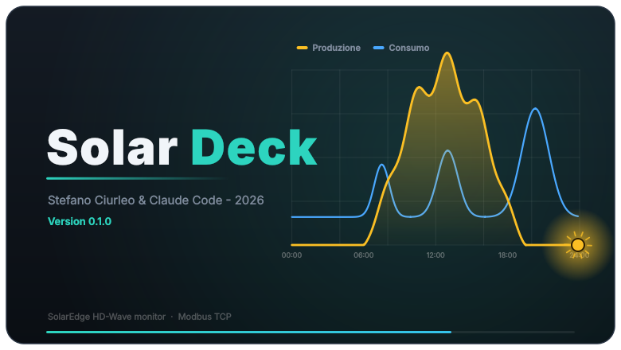
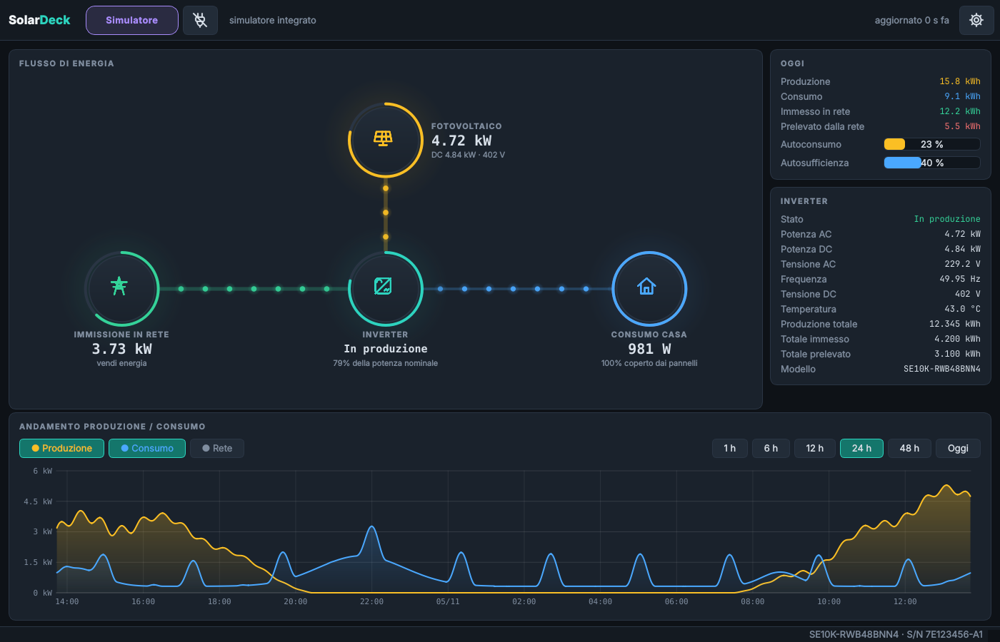
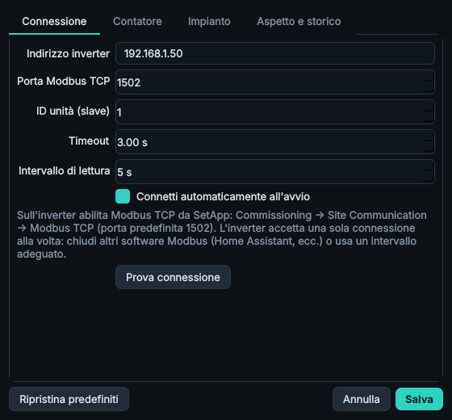

# SolarDeck

<p align="center"></p>

Monitor per inverter **SolarEdge HD-Wave** via **Modbus TCP** (SunSpec): produzione dei pannelli, consumo di casa e
immissione/prelievo dalla rete, con diagramma animato dei flussi e grafico dell'andamento consumo/produzione.
Python 3 + Qt6 (PySide6), stessa interfaccia scura e stessa struttura di [CNC Deck](https://github.com/stefanolmo/cncgrbl).
Nessuna dipendenza oltre a PySide6: il client Modbus TCP è incluso (~100 righe).

<p align="center"></p>

- **Flusso di energia**: fotovoltaico → inverter → casa, rete a sinistra. Le sfere si muovono nel verso dell'energia;
  spessore e velocità seguono la potenza. Gli anelli mostrano il carico dell'impianto, la quota di consumo coperta dai pannelli,
  la potenza scambiata con la rete (verde = immissione, rosso = prelievo).
- **Oggi**: produzione, consumo, immesso, prelevato (kWh), autoconsumo e autosufficienza.
- **Inverter**: stato, potenza AC/DC, tensioni, frequenza, temperatura, contatori totali (inverter e contatore di scambio).
- **Grafico** in basso: produzione e consumo (più, a richiesta, la potenza di rete) su 1 h / 6 h / 12 h / 24 h / 48 h / oggi, con cursore
  che mostra i valori. Lo storico è su disco e sopravvive ai riavvii.
- **Impostazioni** (ingranaggio o `Ctrl+,`): indirizzo, porta, ID unità, timeout, intervallo di lettura, prova connessione, scelta del
  contatore, segno della potenza di rete, potenza dell'impianto, intervallo grafico, storico, splash.

<p align="center"></p>

## Preparare l'inverter

1. Inverter e PC sulla stessa rete (LAN/Wi-Fi). Dai all'inverter un IP fisso (o una prenotazione DHCP sul router).
2. Abilita **Modbus TCP**: SetApp → *Commissioning → Site Communication → Modbus TCP* (porta predefinita **1502**).
3. Per consumo e immissione/prelievo serve il **contatore Export+Import** SolarEdge (o compatibile) collegato all'inverter
   e configurato. Senza contatore l'app mostra solo la produzione.
4. L'inverter accetta **una sola connessione Modbus per volta**: chiudi altri client (Home Assistant, ecc.).

## Installazione (Ubuntu)

```bash
./install.sh            # venv in ~/.local/share/solardeck, comando "solardeck", voce di menu
solardeck               # al primo avvio: ingranaggio -> indirizzo dell'inverter -> "Prova connessione"
solardeck --sim         # prova tutto senza inverter (simulatore Modbus TCP integrato)
solardeck --no-splash   # senza splash screen di 3 secondi (o SOLARDECK_NO_SPLASH=1)
```

Senza installare: `pip install -r requirements.txt && python3 -m solardeck`.

Pacchetto .deb (usa PySide6 di sistema): `packaging/build-deb.sh`, poi `sudo apt install ./dist/solardeck_0.1.0_all.deb`.

## Come sono calcolati i valori

| Valore | Origine (registri SunSpec SolarEdge) |
|---|---|
| Produzione | inverter, `W` (40083) con scale factor 40084; DC da 40100 |
| Rete | contatore 1/2/3, `M_AC_Power` (40206 per il contatore 1) con scale factor 40210; **+ = immissione** |
| Consumo casa | produzione − rete (cioè produzione − immissione + prelievo) |
| kWh di oggi | integrazione (trapezi) dei campioni salvati: contano solo i periodi in cui l'app è in esecuzione |

Se di notte l'app mostra *immissione* mentre stai consumando, nelle impostazioni → *Contatore* scegli
«Positivo = prelievo dalla rete».

Lo storico è in `~/.local/share/solardeck/history.csv`, le impostazioni in `~/.config/solardeck/solardeck.conf`.

## Sviluppo

```bash
pip install -r requirements.txt pytest
QT_QPA_PLATFORM=offscreen python3 -m pytest          # i test usano il simulatore (vero server Modbus TCP locale)
QT_QPA_PLATFORM=offscreen python3 docs/make_screenshots.py
```

Struttura: `modbus.py` (client + decodifica SunSpec), `poller.py` (thread di lettura con riconnessione),
`history.py` (storico CSV, energia), `flowview.py` / `chartview.py` (widget disegnati a mano), `settings_dialog.py`,
`splash.py`, `simulator.py`, `mainwindow.py`.

**Limiti noti**: non sono gestite le batterie SolarEdge né gli inverter multipli in cascata (solo l'unità indicata dall'ID);
la mappa dei registri è quella documentata da SolarEdge ma l'app è stata verificata solo contro il simulatore incluso.
